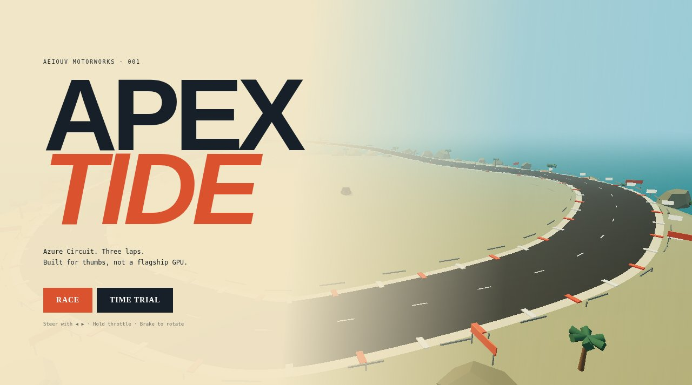

# Apex Tide

A phone-first coastal circuit racer.



**Live:** https://aeiouvcode.github.io/apex-tide/

## About

Three laps of the Azure Circuit along a sea wall. Race five rivals or run a time trial. Tuned for touch controls and modest phone GPUs rather than flagship hardware; best played in landscape.

## Controls

- Steer with ◀ ▶ (arrow keys on desktop)
- Hold throttle
- Brake to rotate the car into corners

## Built with

Three.js r180 (ES module from jsDelivr) and WebGL2, in one `index.html`.

## Run locally

```sh
git clone https://github.com/aeiouvcode/apex-tide.git
cd apex-tide
python3 -m http.server 8000
```

Then open http://localhost:8000.

An internet connection is needed on first load for the Three.js module.
